# Restaurant Management System

Cloud-native restaurant platform built with **Spring Boot 3.3 / Java 21** microservices: edge security on AWS, an orchestrated **Saga**, **Transactional Outbox + Debezium CDC**, **CQRS** (PostgreSQL write model, MongoDB read model), **RBAC + ABAC** security, **Resilience4j**, and **Terraform** for the AWS layer.

Repository: <https://github.com/coder-stat920715/restaurant-system>

> **How to read this document.** Everything here describes what is *actually in this repository*. Where a reference architecture you may have seen elsewhere (Eureka, Kubernetes, mTLS, Caffeine caches, `@RetryableTopic`) is **not** implemented here, this README says so explicitly in [Section 1](#1-scope-what-is-and-is-not-implemented) and explains the equivalent that *is* used. Numbers in "KPIs" and "targets" are **design goals to validate with load tests**, not measured results.

---

## Table of contents

1. [Scope: what is and is not implemented](#1-scope-what-is-and-is-not-implemented)
2. [System at a glance](#2-system-at-a-glance)
3. [High-level design (C4 levels 1 and 2)](#3-high-level-design-c4-levels-1-and-2)
4. [Low-level design (C4 levels 3 and 4)](#4-low-level-design-c4-levels-3-and-4)
5. [Microservice deep dive (six parameters each)](#5-microservice-deep-dive-six-parameters-each)
6. [End-to-end workflow](#6-end-to-end-workflow)
7. [Run the application locally (step by step)](#7-run-the-application-locally-step-by-step)
8. [Testing guide](#8-testing-guide)
9. [Design patterns: what, where, when](#9-design-patterns-what-where-when)
10. [Transactional Outbox vs Debezium CDC (and Saga)](#10-transactional-outbox-vs-debezium-cdc-and-saga)
11. [Failure scenarios and compensation flows](#11-failure-scenarios-and-compensation-flows)
12. [AWS edge: Route 53, CloudFront, WAF, Shield Advanced](#12-aws-edge-route-53-cloudfront-waf-shield-advanced)
13. [Terraform guide](#13-terraform-guide)
14. [Kubernetes (status and a beginner's learning path)](#14-kubernetes-status-and-a-beginners-learning-path)
15. [Security, reliability and compliance summary](#15-security-reliability-and-compliance-summary)
16. [Known limitations and roadmap](#16-known-limitations-and-roadmap)
17. [Troubleshooting](#17-troubleshooting)

---

## 1. Scope: what is and is not implemented

Some reference diagrams use different names and include components that this project deliberately does not contain. Use this table to translate.

| Reference-architecture element | Status in this repo | What the repo does instead |
|---|---|---|
| `order-command` service | Implemented as **`order-service`** | Command side of CQRS **and** the saga orchestrator |
| `order-query` service | Implemented as **`order-query-service`** | MongoDB read model fed from Kafka |
| `payment` service | Implemented as **`payment-service`** | Executes payment/refund commands, calls a PSP with Resilience4j |
| Eureka server + client-side load balancing | **Not implemented** | Local: fixed URLs in `application.yml`/env vars (`localhost:808x`). AWS: **AWS Cloud Map** DNS names (`order-service.restaurant.local`) created by `infra/terraform/ecs.tf` |
| Kubernetes manifests | **Not implemented** | Containers run on **Amazon ECS Fargate** (Terraform). See [Section 14](#14-kubernetes-status-and-a-beginners-learning-path) for a concept mapping and learning path |
| mTLS between gateway and services | **Not implemented** | Plain HTTP inside private subnets, protected by security groups (only the app security group can talk to services). mTLS would be added with a service mesh or per-service certificates |
| Caffeine (L1) + Redis (L2) cache in `order-query` | **Not implemented** | `order-query-service` reads MongoDB directly. Redis is used **only** for gateway rate limiting |
| Kafka topics `order-events`, `payment-events`, `payment-results` | Different names | `restaurant.events.order`, `restaurant.events.saga-payment`, `restaurant.events.saga-kitchen`, `restaurant.events.saga-reply` |
| `@RetryableTopic` retry topics + `payment-events.DLT` | **Not used** | Spring Kafka `DefaultErrorHandler` with exponential backoff, then a **dead-letter topic** `<topic>.DLT` (payment, kitchen, workflow, query services) |
| "Passenger name starting with FAIL declines payment" | Domain differs (restaurant, not booking) | An **order total above 500** is declined by the simulated PSP; **50 salads** triggers out-of-stock; PSP outage is simulated with `psp.fake.failure-rate`. See [Section 11](#11-failure-scenarios-and-compensation-flows) |
| API gateway circuit-breaker filter | Not enabled in YAML | A `FallbackController` exists; the Resilience4j circuit breaker is applied on the **PSP client** in `payment-service` |

---

## 2. System at a glance

| Service | Port | Database | Role |
|---|---|---|---|
| `api-gateway` | 8080 | Redis (rate limits) | Entry point: JWT validation, rate limiting, routing |
| `order-service` | 8081 | PostgreSQL `orders` | Accepts orders, owns order state, **saga orchestrator**, outbox, replay |
| `order-query-service` | 8082 | MongoDB `orders_read` | CQRS read model, query API, rebuild admin API |
| `payment-service` | 8085 | PostgreSQL `payments` | Charges and refunds via PSP client (retry + circuit breaker) |
| `kitchen-inventory-service` | 8086 | PostgreSQL `kitchen` | All-or-nothing stock reservation |
| `kitchen-workflow-service` | 8087 | PostgreSQL `workflow` | Kitchen tickets (QUEUED, PREPARING, READY, SERVED) with ABAC |

Supporting infrastructure (local via Docker Compose, AWS via Terraform): PostgreSQL (logical WAL), Apache Kafka, Kafka Connect + **Debezium**, MongoDB, Redis, Keycloak (OIDC).

Repository layout:

```
restaurant-system/
  pom.xml                      parent POM (6 modules, shared test dependencies)
  api-gateway/ order-service/ order-query-service/
  payment-service/ kitchen-inventory-service/ kitchen-workflow-service/
  local-stack/                 docker-compose, Debezium connector JSONs, Keycloak realm, scripts
  infra/terraform/             AWS infrastructure as code
  Dockerfile                   one build recipe for every module (--build-arg MODULE=...)
  requests.http                IntelliJ HTTP client: main end-to-end scenarios
  requests-kitchen.http        kitchen workflow + read-model replay scenarios
  PROJECT_STRUCTURE.md         class-by-class map of every module
```

---

## 3. High-level design (C4 levels 1 and 2)

The **C4 model** describes software at four zoom levels: **C**ontext, **C**ontainers, **C**omponents, **C**ode. Levels 1 and 2 are the HLD; levels 3 and 4 are in [Section 4](#4-low-level-design-c4-levels-3-and-4).

### C4 Level 1: System context

*Who uses the system and which external systems does it depend on?*

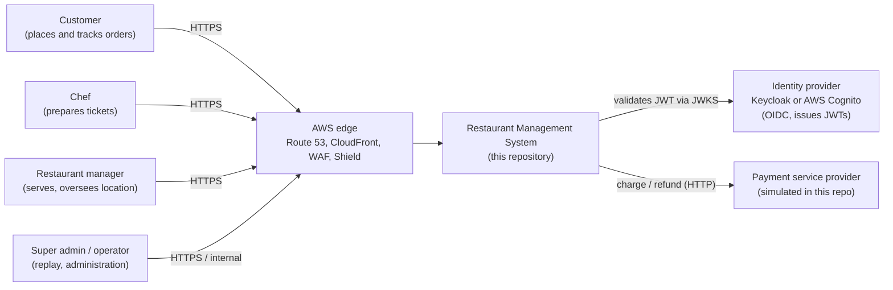

### C4 Level 2: Containers

*Which separately deployable units exist and how do they talk?*

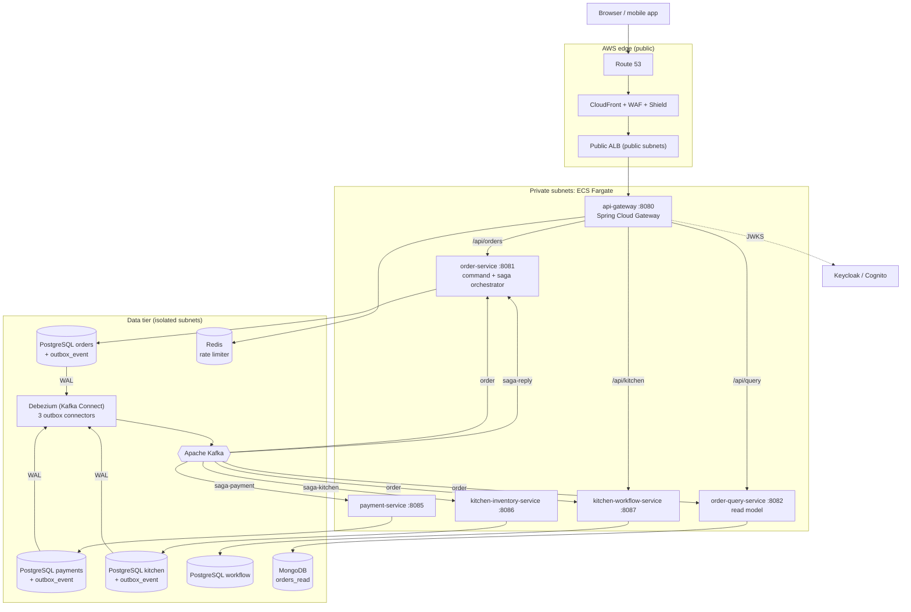

**Key HLD decisions**

| Decision | Reason |
|---|---|
| Database per service | Independent schema evolution and failure isolation |
| Commands as Kafka messages, replies as Kafka messages | The saga survives restarts and slow participants; no synchronous call chain |
| Every service writes events through its **own outbox table** | No "dual write" (DB + Kafka) inconsistency |
| Debezium reads the WAL instead of the application publishing to Kafka | Events cannot be lost if the app crashes between commit and publish |
| CQRS | Reads (kitchen board, "my orders") scale and shape independently of writes |
| Only the gateway is reachable from the internet path | One place for authentication and abuse control |

---

## 4. Low-level design (C4 levels 3 and 4)

### C4 Level 3: Components inside `order-service`

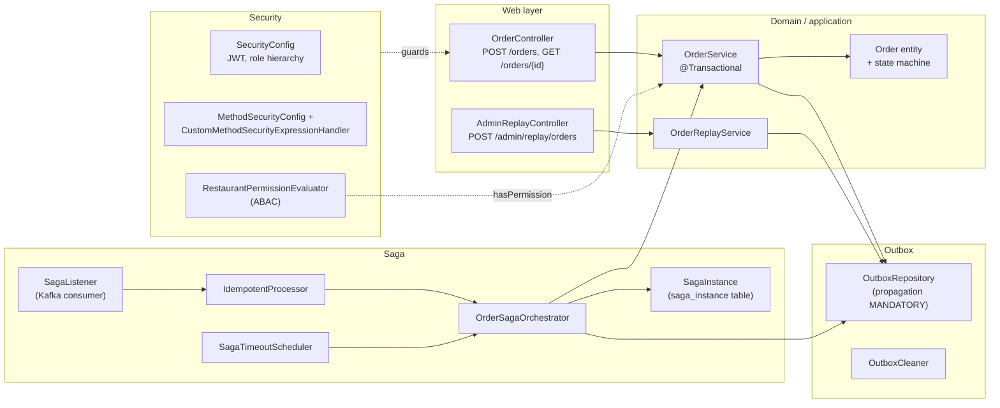

### C4 Level 3: Components inside `payment-service`

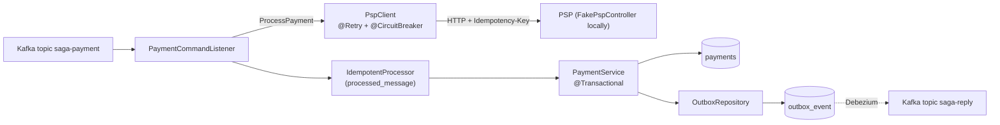

### C4 Level 3: Components inside `order-query-service`

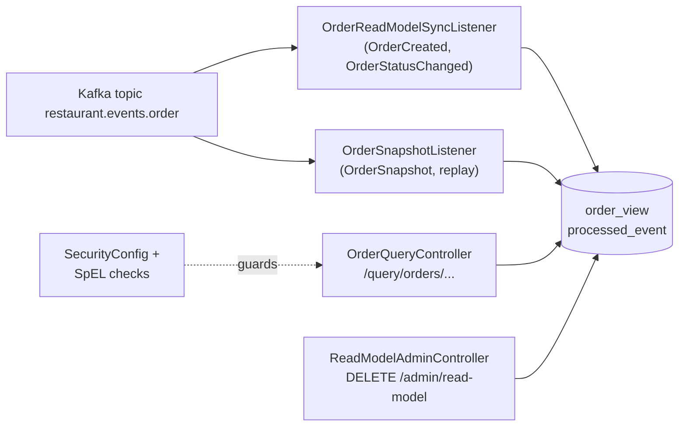

### C4 Level 4: Code level (key classes of the order aggregate and saga)

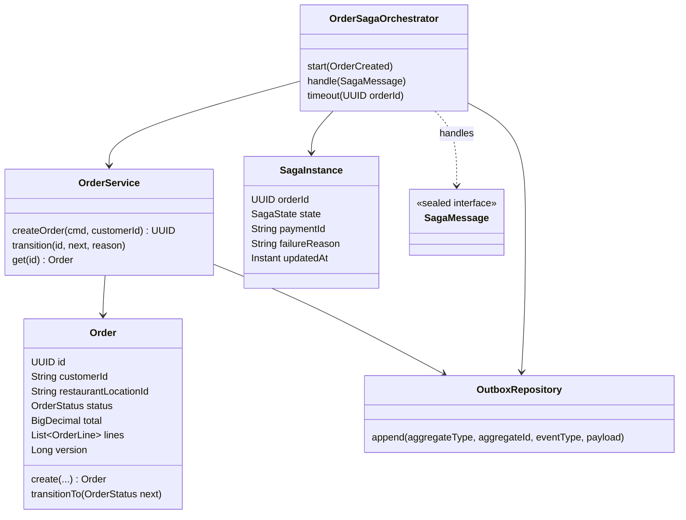

**Order state machine** (`Order.transitionTo` rejects anything else):

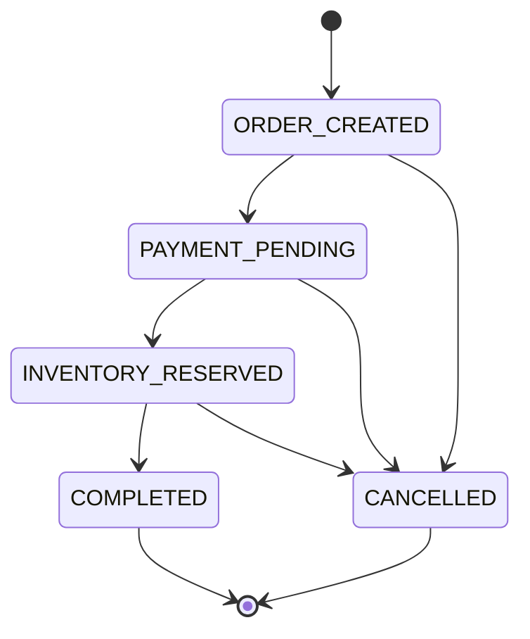

**Saga state machine** (`SagaInstance.state`, owned by the orchestrator):

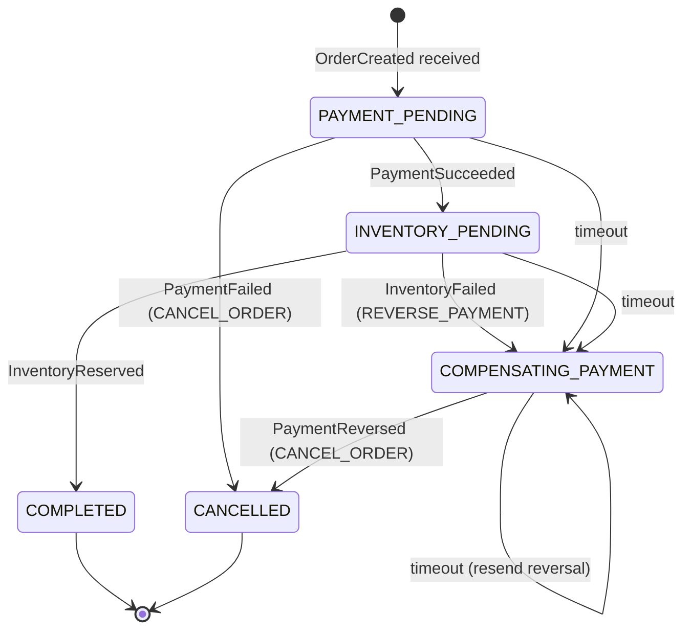

**Kitchen ticket state machine** (`TicketStatus.canMoveTo`, one step forward only):

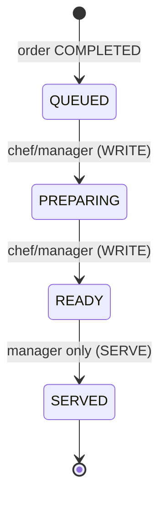

### Data model (per database)

| Database | Table | Purpose |
|---|---|---|
| `orders` | `orders` | Order aggregate (JSONB `lines`, `version` for optimistic locking) |
| `orders` | `saga_instance` | Saga state per order (`state`, `payment_id`, `failure_reason`, `updated_at`, `version`) |
| `orders` | `outbox_event` | Events and saga **commands** to publish (`aggregate_type` decides the topic) |
| `orders` | `processed_message` | Idempotent-consumer markers (`event_id`) |
| `payments` | `payments` | One row per order (`CHARGED`, `FAILED`, `REVERSED`) |
| `payments` / `kitchen` | `outbox_event`, `processed_message` | Same pattern as above |
| `kitchen` | `inventory`, `reservations` | Stock (`CHECK stock >= 0`) and decisions (`RESERVED`, `FAILED`) |
| `workflow` | `order_snapshot`, `kitchen_ticket`, `processed_message` | Location + items per order; ticket workflow |
| MongoDB | `order_view`, `processed_event` | Read model and dedup markers |

### Kafka event catalog

| Topic (key = `orderId`) | Event types | Producer | Consumers (group) |
|---|---|---|---|
| `restaurant.events.order` | `OrderCreated`, `OrderStatusChanged`, `OrderSnapshot` | order-service (outbox) | order-service (`order-service-saga`), order-query (`order-read-model`, `order-read-model-snapshots`), kitchen-workflow (`kitchen-workflow`) |
| `restaurant.events.saga-payment` | `ProcessPayment`, `ReversePayment` | order-service (outbox) | payment-service (`payment-service`) |
| `restaurant.events.saga-kitchen` | `ReserveInventory` | order-service (outbox) | kitchen-inventory (`kitchen-service`) |
| `restaurant.events.saga-reply` | `PaymentSucceeded`, `PaymentFailed`, `PaymentReversed`, `InventoryReserved`, `InventoryFailed` | payment-service, kitchen-inventory (outbox) | order-service (`order-service-saga`) |
| `<topic>.DLT` | the failing record | `DeadLetterPublishingRecoverer` | operators (manual inspection) |

Debezium maps each outbox row to a Kafka record: **topic** = `restaurant.events.` + `aggregate_type`, **key** = `aggregate_id`, **value** = `payload` (JSON), **headers** `eventType` and `eventId` (= outbox row id, used for idempotency).

### HTTP API catalog

| Method + path (through gateway) | Service | Who may call |
|---|---|---|
| `POST /api/orders` | order-service | `CUSTOMER` (hierarchy: managers and admins inherit) |
| `GET /api/orders/{id}` | order-service | ABAC: owner, or staff of the same location, or admin |
| `GET /api/query/orders/{id}`, `/mine`, `/kitchen-board?status=` | order-query | owner / same-location staff / chef / admin |
| `GET /api/kitchen/tickets?status=` | kitchen-workflow | chef+ (own location; admin may pass `locationId`) |
| `GET /api/kitchen/tickets/{id}` | kitchen-workflow | staff of the ticket's location |
| `POST /api/kitchen/tickets/{id}/start`, `/ready` | kitchen-workflow | chef or manager, same location, restaurant open |
| `POST /api/kitchen/tickets/{id}/serve` | kitchen-workflow | **manager only**, ticket must be READY |
| `DELETE /admin/read-model`, `GET /admin/read-model/stats` (port 8082) | order-query | `SUPER_ADMIN`, internal only |
| `POST /admin/replay/orders?batchSize=` (port 8081) | order-service | `SUPER_ADMIN`, internal only |
| `GET /inventory` (port 8086) | kitchen-inventory | **no authentication; keep internal** |

---

## 5. Microservice deep dive (six parameters each)

Every service is described by the same six parameters: **(1)** purpose and responsibilities, **(2)** KPIs, **(3)** data flow, response times and failure impact, **(4)** technologies with advantages and limitations, **(5)** scalability and performance targets, **(6)** security, reliability and compliance.

### 5.1 `api-gateway`

**1. Primary purpose and key responsibilities**
- Single entry point behind the public ALB; the only service reachable from the internet path.
- Validates the JWT on every request (OAuth2 resource server). Only `/actuator/health/**` and `/fallback/**` are public.
- Token-bucket **rate limiting** per authenticated user (`RedisRateLimiter`), falling back to client IP.
- Routes: `/api/orders/**` to order-service, `/api/query/**` to order-query-service, `/api/kitchen/**` to kitchen-workflow-service; strips the `/api` prefix.
- Removes any client-supplied `X-User-Id` and re-adds the verified subject for downstream logging.

**2. Measuring success (KPIs)**
- Added latency p95 below 10 ms; availability 99.95%; 5xx rate below 0.1%.
- 429 rate (abuse control working, not hurting normal users); 401/403 ratio (auth health).

**3. Data flow, response times, failure impact**
- Synchronous: `client -> gateway -> service -> response`. The gateway adds only auth and a Redis round trip (about 1-2 ms).
- Redis unreachable: Spring Cloud Gateway's rate limiter **fails open** (requests pass, error is logged). Availability wins over limiting.
- Identity provider unreachable: cached JWKS keeps validating tokens; new keys cannot be fetched until it returns.
- Downstream service down: the client receives a gateway error (502/503). No circuit-breaker filter is configured in YAML today (a `FallbackController` is ready to be wired).
- Gateway down: **everything** is unavailable, so run at least two tasks across AZs.

**4. Technologies, advantages, limitations**
- Spring Cloud Gateway (WebFlux/Netty), Spring Security resource server, Redis (reactive).
- Advantages: non-blocking, declarative routes and filters, built-in rate limiter.
- Limitations: one global limit profile (20 req/s, burst 40); routes are static (no registry); extra hop; Redis is a soft dependency.

**5. Scalability and performance targets** (to validate by load test)
- Stateless: scale horizontally; ECS autoscaling on CPU 60% (Terraform `aws_appautoscaling_policy.gateway_cpu`), 2 to 8 tasks.
- Target: 1,000+ req/s per 0.5 vCPU task for pass-through traffic.

**6. Security, reliability, compliance**
- JWT signature, issuer and expiry checked; CSRF disabled (stateless bearer tokens); TLS ends at CloudFront and the ALB; WAF and Shield sit upstream.
- Gateway security group accepts traffic only from the ALB on port 8080.
- Logs must never contain tokens. No payment data passes through (the PSP is called server-side from payment-service).

### 5.2 `order-service` (order-command)

**1. Primary purpose and key responsibilities**
- Accept and price orders (`POST /orders`), persist the `Order` and its `OrderCreated` outbox event in **one transaction**.
- Enforce the order state machine; publish every status change as `OrderStatusChanged`.
- **Saga orchestrator**: reacts to `OrderCreated` and participant replies, sends commands, compensates, and times out stuck sagas.
- ABAC-protected order reads; admin replay (`OrderSnapshot` events) for read-model rebuilds.

**2. KPIs**
- Create-order p95 below 150 ms (one DB transaction).
- Saga end-to-end p95 below 3 s on the happy path; compensation rate; **stuck sagas = 0** (timeout watchdog); outbox-to-Kafka lag below 1 s; duplicate side-effects = 0.

**3. Data flow, response times, failure impact**
- Request path: `gateway -> order-service -> PostgreSQL` then `202 Accepted` with the `orderId`. Everything after that is asynchronous.
- PostgreSQL down: no new orders (503). Reads still work from the query side.
- Kafka or Debezium down: orders are still accepted (outbox rows accumulate); the saga pauses; when Debezium recovers it resumes from the WAL position. If it takes longer than `saga.timeout` (2 minutes), the watchdog compensates.
- Payment or kitchen service down: the saga times out and the order becomes `CANCELLED` (payment reversed if it had succeeded).

**4. Technologies, advantages, limitations**
- Spring Boot 3.3, Spring Data JPA/Hibernate, Flyway, PostgreSQL 16, Spring Kafka, Spring Security 6, JDBC for the outbox.
- Advantages: ACID aggregate, atomic event publication, explicit saga state that is easy to inspect (`saga_instance`).
- Limitations: orchestrator concentrates coordination logic (but is stateless and horizontally scalable); eventual consistency for every reader; `order-service` still uses Spring's default Kafka error handler (no dead-letter topic yet, see [Section 16](#16-known-limitations-and-roadmap)).

**5. Scalability and performance targets**
- Stateless; scale by adding tasks. Kafka consumer parallelism is capped by partitions (3 per topic).
- Write throughput is bounded by the `orders` database; target 100+ orders/s per instance before tuning.

**6. Security, reliability, compliance**
- `hasRole('CUSTOMER')` on creation; `@PostAuthorize hasPermission(returnObject, 'READ')` on reads; admin endpoint needs `SUPER_ADMIN`; Bean Validation on input.
- Reliability: outbox, idempotent consumers (`processed_message`), optimistic locking (`@Version`), saga watchdog.
- Compliance: stores only `customerId` (JWT subject), no card data; events form an audit trail.

### 5.3 `order-query-service` (order-query)

**1. Primary purpose and key responsibilities**
- Maintain the **read model** in MongoDB from `restaurant.events.order` events.
- Serve fast projections: single order, "my orders", kitchen board by status and location.
- Rebuild support: apply `OrderSnapshot` events; admin endpoints to clear and count the read model.

**2. KPIs**
- Query p95 below 50 ms; projection lag (event produced to document updated) p95 below 2 s; availability 99.95%.
- Replay parity: documents after rebuild equals orders in the write database (100%).

**3. Data flow, response times, failure impact**
- Asynchronous in, synchronous out: `Kafka -> listener -> MongoDB`; `client -> gateway -> controller -> MongoDB`.
- Service down: reads fail but **writes are unaffected**; on restart it resumes from its committed offsets and catches up.
- MongoDB down: listener retries with exponential backoff (500 ms, factor 2, 5 attempts) and then parks the record on `restaurant.events.order.DLT`.
- Reads can be stale by the projection lag. There is **no cache layer** in this version.

**4. Technologies, advantages, limitations**
- Spring Data MongoDB, Spring Kafka, Spring Security.
- Advantages: schema-flexible documents, compound index on `(locationId, status)`, independent scaling from writes.
- Limitations: eventual consistency; dedup markers need housekeeping; no cursor pagination; the live listener stamps `updatedAt` with processing time (used by replay conflict rules).

**5. Scalability and performance targets**
- Scale tasks for read load; consumer parallelism bounded by partitions; MongoDB replica set or sharding for data growth.
- Target: 500+ reads/s per task from Mongo with the index.

**6. Security, reliability, compliance**
- JWT required; ownership and location rules in SpEL (`returnObject.customerId() == authentication.name`, location claim match); admin endpoints `SUPER_ADMIN`.
- Reliability: idempotent projection (marker insert, undone on failure), replayable from the write model at any time.

### 5.4 `payment-service`

**1. Primary purpose and key responsibilities**
- Execute `ProcessPayment` (charge) and `ReversePayment` (refund = saga compensation) commands.
- Call the PSP through a **resilient client**: Retry (exponential backoff + jitter) wrapping a Circuit Breaker.
- Persist the payment and the reply event atomically; reply on `saga-reply`.

**2. KPIs**
- Payment success rate (excluding genuine declines) above 99%; PSP call p95 below 800 ms.
- Circuit-breaker open time; refund eventually-success 100%; **DLT depth = 0**; double charges = 0.

**3. Data flow, response times, failure impact**
- `Kafka (ProcessPayment) -> PSP HTTP call -> DB transaction (payments + outbox) -> Debezium -> saga-reply`.
- Decline (amount above 500 in the fake PSP): immediate `PaymentFailed`, saga cancels the order.
- PSP slow or failing: up to 4 attempts (200 ms, 400 ms, 800 ms, each randomized by +/-50%); then the fallback returns `UNAVAILABLE`, which becomes `PaymentFailed`. After 50% failures over 10+ calls the circuit opens for 20 s and calls fail fast.
- Service down: commands wait in Kafka; the order saga times out and compensates.

**4. Technologies, advantages, limitations**
- Spring Kafka, JDBC, Resilience4j (`@Retry`, `@CircuitBreaker`), `RestClient`, Flyway, PostgreSQL.
- Advantages: protects the platform from a failing provider; `Idempotency-Key` header (= `orderId`) makes retries and redeliveries safe.
- Limitations: the PSP call happens outside the DB transaction (by design; the idempotency key closes the gap); PSP here is simulated; no bulkhead or rate limiter yet.

**5. Scalability and performance targets**
- Scale tasks up to partition count; respect PSP rate limits (add a Resilience4j rate limiter or bulkhead when integrating a real provider).
- Target: 100+ payments/s per instance (PSP permitting).

**6. Security, reliability, compliance**
- No public route; only the app security group can reach it. No card numbers are stored; PSP credentials belong in Secrets Manager.
- PCI scope is minimized by design (tokenized PSP flow); idempotent commands; failing records go to `restaurant.events.saga-payment.DLT`.

### 5.5 `kitchen-inventory-service`

**1. Primary purpose and key responsibilities**
- Reserve stock for an order **all-or-nothing** (`ReserveInventory`), answer `InventoryReserved` or `InventoryFailed`.
- Lock rows in sorted order (`SELECT ... FOR UPDATE`) to prevent overselling and deadlocks; one decision per order (idempotent).

**2. KPIs**
- Reservation p95 below 100 ms; oversell count = 0; stock accuracy 100%; failure-due-to-stock rate (business KPI).

**3. Data flow, response times, failure impact**
- `Kafka (ReserveInventory) -> DB transaction (stock update + reservation + outbox) -> Debezium -> saga-reply`.
- Insufficient stock: no stock is changed; `InventoryFailed` makes the saga reverse the payment and cancel.
- Service down: saga stays `INVENTORY_PENDING`, then the watchdog compensates after 2 minutes.

**4. Technologies, advantages, limitations**
- JDBC, PostgreSQL row locks, Flyway (seed data: burger 100, pizza 50, salad 20).
- Advantages: strong consistency for stock; simple and fast. Limitations: hot-item lock contention; stock is not released if an order is cancelled **after** it was completed (not modelled); `GET /inventory` is unauthenticated (internal use).

**5. Scalability and performance targets**
- Scale tasks; contention is per item row. Target 200+ reservations/s on distinct items.

**6. Security, reliability, compliance**
- Internal only (security group). Idempotent; atomic outbox reply; DLT for poison messages (`restaurant.events.saga-kitchen.DLT`).

### 5.6 `kitchen-workflow-service`

**1. Primary purpose and key responsibilities**
- Turn a completed order into a **kitchen ticket** and manage its lifecycle: `QUEUED -> PREPARING -> READY -> SERVED`.
- Enforce **ABAC** on every transition (location, role, opening hours, ticket state).

**2. KPIs**
- Ticket creation lag after `COMPLETED` below 2 s; average time QUEUED to READY (business KPI); invalid-transition (409) and denied (403) counts.

**3. Data flow, response times, failure impact**
- `Kafka order events -> snapshot (OrderCreated) -> ticket (OrderStatusChanged = COMPLETED)`; chefs call REST through the gateway.
- Service down: orders still complete; tickets appear when it restarts (offsets are committed only after processing).
- Concurrent updates: compare-and-set (`UPDATE ... WHERE status = expected`) returns 409 to the loser.

**4. Technologies, advantages, limitations**
- JDBC, Spring Security with a dedicated `TicketPermissionEvaluator`, Spring Kafka.
- Limitations: opening hours are a placeholder (08:00-23:00 UTC); ticket creation relies on having seen the `OrderCreated` event first (same partition key keeps order).

**5. Scalability and performance targets**
- Index on `(location_id, status)`; scale tasks; target 300+ ticket operations/s.

**6. Security, reliability, compliance**
- Chef and manager must carry the `restaurantLocationId` claim matching the ticket; `SERVE` is manager-only; `SUPER_ADMIN` bypass is audited through logs; idempotent consumer; DLT.

### 5.7 Platform components (same six parameters, condensed)

| Component | Purpose | KPIs | Failure impact | Tech notes | Scale target | Security / reliability |
|---|---|---|---|---|---|---|
| **Kafka** (MSK) | Durable event backbone | Consumer lag, under-replicated partitions = 0 | Saga and projections pause; no data loss | 3 partitions per topic, RF 3 on AWS | Add partitions + consumers | TLS in transit, ACLs/IAM in hardened setups |
| **Debezium** (Kafka Connect / MSK Connect) | WAL to Kafka relay for 3 outbox tables | Connector `RUNNING`, replication slot lag below 1 s | Events delayed, outbox grows (not lost) | `pgoutput`, EventRouter SMT, one slot per DB | 1 task per connector | Replication user; monitor slot size |
| **PostgreSQL** (RDS) | System of record per service | Replica/slot lag, p95 query time | Service-specific outage | Logical replication on (`rds.logical_replication=1`) | Vertical + read replicas | Encrypted, managed password in Secrets Manager |
| **MongoDB** (DocumentDB on AWS) | Read model store | Query p95, replication lag | Reads fail or stale | Index `locationId,status` | Replica set / sharding | TLS, credentials in Secrets Manager |
| **Redis** | Rate-limit counters only | Latency, evictions | Limiter fails open | Lua token bucket | Replication group | TLS, private subnet |
| **Keycloak / Cognito** | Issues JWTs | Token endpoint latency, login errors | No new logins; cached keys still verify | Realm `restaurant`, 4 roles | Clustered / managed | Short token life, MFA in production |

---

## 6. End-to-end workflow

### 6.1 Production path (as built by `infra/terraform`)

```
Client
  -> Route 53 (alias record + HTTPS health check on /actuator/health)
  -> CloudFront (TLS 1.2+, caching disabled for the API) + AWS WAF (managed rules + per-IP rate rule)
     + Shield Advanced (optional protection on CloudFront and the ALB)
  -> public ALB  (public subnets, HTTPS only, rejects requests without the secret X-Origin-Verify header)
  -> api-gateway (ECS Fargate, private subnets): JWT validation, Redis rate limiting, routing
  -> plain HTTP over AWS Cloud Map DNS (order-service.restaurant.local ...), allowed only by security groups
  -> order-service | order-query-service | kitchen-workflow-service

order-service  -> PostgreSQL "orders" (orders, saga_instance, outbox_event written in ONE transaction)
               -> Debezium (reads the WAL) -> Kafka  restaurant.events.order
                                                     restaurant.events.saga-payment
                                                     restaurant.events.saga-kitchen

payment-service           <- Kafka saga-payment  -> PSP (Retry + CircuitBreaker) -> PostgreSQL "payments"
                           (failures: backoff, then saga-payment.DLT)          -> outbox -> Debezium -> saga-reply
kitchen-inventory-service <- Kafka saga-kitchen  -> PostgreSQL "kitchen"      -> outbox -> Debezium -> saga-reply
order-service             <- Kafka saga-reply    -> saga advances / compensates -> new outbox rows

order-query-service       <- Kafka restaurant.events.order -> MongoDB read model  <- reads via gateway
kitchen-workflow-service  <- Kafka restaurant.events.order -> PostgreSQL "workflow" tickets <- chefs via gateway
```

> Locally the first part (Route 53 to ALB) does not exist: clients call the gateway on `localhost:8080` directly.

### 6.2 Happy path, step by step

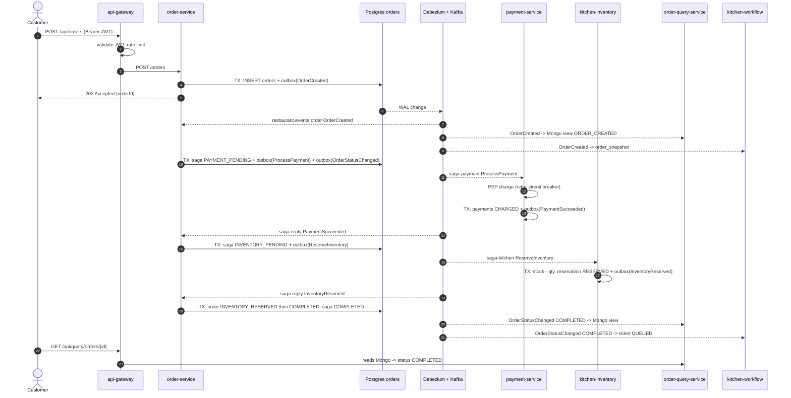

Numbered narrative:

1. The client sends `POST /api/orders` with a Keycloak JWT. The gateway checks the token and the rate limit, strips `/api`, and forwards to `order-service`.
2. `OrderService.createOrder` (one DB transaction) saves the order as `ORDER_CREATED` and an `OrderCreated` row in `outbox_event`. The client gets **202** immediately.
3. Debezium sees the new outbox row in the WAL and publishes it to `restaurant.events.order` (key = `orderId`).
4. `order-service` consumes its own `OrderCreated` event. `OrderSagaOrchestrator.start` records the saga (`PAYMENT_PENDING`), moves the order to `PAYMENT_PENDING`, and writes a `ProcessPayment` command to the outbox.
5. `payment-service` consumes the command, calls the PSP, stores the payment and writes `PaymentSucceeded` to its own outbox. The reply reaches `order-service` through `saga-reply`.
6. The orchestrator moves to `INVENTORY_PENDING` and sends `ReserveInventory`. `kitchen-inventory-service` reserves stock and replies.
7. On `InventoryReserved` the order goes `INVENTORY_RESERVED` then `COMPLETED`.
8. In parallel, `order-query-service` and `kitchen-workflow-service` consume the order events: Mongo document updated, kitchen ticket opened (`QUEUED`).
9. Chefs advance the ticket through the gateway; the manager serves it.

---

## 7. Run the application locally (step by step)

### 7.1 Prerequisites

| Tool | Version | Note |
|---|---|---|
| JDK | **21** recommended | The build targets Java 21. If Maven runs on JDK 24/25, the parent POM already sets `-Dnet.bytebuddy.experimental=true` for tests |
| Maven | 3.9+ | `mvn -v` shows the JDK Maven uses |
| Docker Desktop | recent | Needed for the local stack and for the integration tests |
| IntelliJ IDEA | any | Optional; its HTTP client runs `requests.http` |

```
git clone https://github.com/coder-stat920715/restaurant-system.git
cd restaurant-system
mvn clean install -DskipTests          # build all 6 modules (add tests later, see Section 8)
```

### 7.2 There is no Eureka server to start

Classic Spring Cloud setups start **Eureka first**, then the gateway, then services. This project has **no service registry**: the gateway reads fixed URLs (`ORDER_URL`, `QUERY_URL`, `KITCHEN_WORKFLOW_URL`, defaulting to `localhost:8081/8082/8087`), and services talk to each other **only through Kafka**, so no service needs the address of another. In AWS, Cloud Map provides DNS names instead of Eureka. Therefore the start order below is driven by **infrastructure dependencies**, not by registration.

### 7.3 Startup order and why

| Step | What to start | Why it must come at this point |
|---|---|---|
| 1 | **Infrastructure**: `cd local-stack` then `docker compose up -d` | Everything depends on Postgres, Kafka, Connect, Mongo, Redis, Keycloak |
| 2 | Wait until healthy (Keycloak needs 30-60 s to import the realm) | The gateway and services call Keycloak for JWKS |
| 3 | **`order-service`** (8081) | Flyway creates `orders`, `saga_instance`, `outbox_event`; creates Kafka topics |
| 4 | **`payment-service`** (8085) | Flyway creates its tables; subscribes to `saga-payment` |
| 5 | **`kitchen-inventory-service`** (8086) | Flyway creates stock tables and seeds items; subscribes to `saga-kitchen` |
| 6 | **`kitchen-workflow-service`** (8087) | Needs the `workflow` database; subscribes to order events |
| 7 | **Register Debezium connectors**: `register-connectors.cmd` (Windows) or `./register-connectors.sh` | Connectors need the `outbox_event` tables to exist, which Flyway created in steps 3-5 |
| 8 | **`order-query-service`** (8082) | Needs Mongo and the order events topic (created in step 3) |
| 9 | **`api-gateway`** (8080) | Last, because it is the front door; needs Redis and Keycloak |

Steps 3-6 can run in any order among themselves. Run each one in IntelliJ (main class, for example `OrderApplication`) or from a terminal:

```
mvn -pl order-service spring-boot:run
mvn -pl payment-service spring-boot:run
mvn -pl kitchen-inventory-service spring-boot:run
mvn -pl kitchen-workflow-service spring-boot:run
cd local-stack && register-connectors.cmd
mvn -pl order-query-service spring-boot:run
mvn -pl api-gateway spring-boot:run
```

If you already ran an older copy of the stack: `docker compose down -v` first. If the `workflow` database is missing: `docker compose exec postgres psql -U postgres -c "CREATE DATABASE workflow;"`.

### 7.4 Verify the stack

| Check | Command or URL | Expected |
|---|---|---|
| Connectors | `curl.exe http://localhost:8083/connectors` | `["orders-outbox","payments-outbox","kitchen-outbox"]` |
| One connector | `curl.exe http://localhost:8083/connectors/orders-outbox/status` | `"state":"RUNNING"` |
| Service health | `curl.exe http://localhost:8081/actuator/health` (also 8082, 8085, 8086, 8087, 8080) | `{"status":"UP"}` |
| Topics | Kafka UI <http://localhost:8090> | the four `restaurant.events.*` topics |
| Stock | `curl.exe http://localhost:8086/inventory` | burger 100, pizza 50, salad 20 |
| Keycloak | <http://localhost:8180> (admin/admin), realm **restaurant** | users alice, bob, chef1, manager1, admin1 |

Local users (all passwords `password`): `alice`, `bob` (CUSTOMER), `chef1` (CHEF, location `loc-1`), `manager1` (RESTAURANT_MANAGER, `loc-1`), `admin1` (SUPER_ADMIN).

---

## 8. Testing guide

### 8.1 Automated tests

```
mvn clean install                    # unit tests + (Docker available) integration tests
mvn -pl order-service test           # one module
mvn -pl order-query-service test -Dtest=OrderSnapshotListenerTest
```

| Module | Test | Needs Docker | What it proves |
|---|---|---|---|
| order-service | `OrderStateMachineTest` | no | legal and illegal order transitions |
| order-service | `RestaurantPermissionEvaluatorTest` | no | ABAC matrix (owner, location, hours, state, admin) |
| order-service | `OrderSagaIntegrationTest` | **yes** | real Postgres + Kafka: happy path, payment failure, inventory failure + reversal, late reply ignored, 401/403 rules, validation |
| order-query-service | `OrderReadModelSyncListenerTest` | no | projection, duplicate skip, unknown events, marker removal on failure |
| order-query-service | `OrderSnapshotListenerTest` | no | replay upsert rules (never overwrite newer data) |
| order-query-service | `OrderQueryApiIntegrationTest` | **yes** (Mongo) | owner/location/role rules, admin clear |
| kitchen-workflow-service | `TicketStatusTest`, `TicketPermissionEvaluatorTest` | no | one-step transitions; chef vs manager vs admin rules |

Without Docker the integration tests report *Skipped* (they are annotated with `disabledWithoutDocker`). The test `TestOutboxRelay` stands in for Debezium inside the integration test; Debezium itself is verified by the manual scenarios below.

### 8.2 Manual end-to-end testing

Open `requests.http` (IntelliJ HTTP client) and run the requests from the top; each file stores tokens and the last `orderId` in variables. With `curl.exe` on Windows:

```
curl.exe -s -X POST http://localhost:8180/realms/restaurant/protocol/openid-connect/token ^
  -d "grant_type=password" -d "client_id=restaurant-web" -d "username=alice" -d "password=password"
:: copy access_token, then
curl.exe -s -X POST http://localhost:8080/api/orders -H "Authorization: Bearer <TOKEN>" -H "Content-Type: application/json" ^
  -d "{\"locationId\":\"loc-1\",\"lines\":[{\"menuItemId\":\"burger\",\"quantity\":2,\"unitPrice\":9.50}]}"
```

**Where to look while testing**

| What | How |
|---|---|
| Events on Kafka | Kafka UI <http://localhost:8090>, topics `restaurant.events.*` (check headers `eventType`, `eventId`) |
| Order and saga state | `docker compose exec postgres psql -U postgres -d orders -c "select id,status from orders order by created_at desc limit 5;"` and `-c "select order_id,state,failure_reason from saga_instance order by updated_at desc limit 5;"` |
| Payments | `... -d payments -c "select order_id,status from payments order by created_at desc;"` |
| Stock and reservations | `curl.exe http://localhost:8086/inventory`; `... -d kitchen -c "select * from reservations;"` |
| Read model | `docker compose exec mongo mongosh orders_read --quiet --eval "db.order_view.find().pretty()"` |
| Tickets | `... -d workflow -c "select id,status,updated_by from kitchen_ticket;"` |
| Logs | each service console in IntelliJ |

### 8.3 Test scenarios with expected results

| # | Scenario | Steps | Expected result |
|---|---|---|---|
| S1 | **Happy path** | alice orders 2 burgers (9.50) | `202`; within 2-3 s order `COMPLETED` (query API); `payments` row `CHARGED`; burger stock 98; saga `COMPLETED`; ticket `QUEUED` for `loc-1` |
| S2 | **Payment declined** | alice orders 1 burger at **600.00** | order ends `CANCELLED`; `payments` row `FAILED`; no reservation; stock unchanged |
| S3 | **Out of stock + compensation** | alice orders **50 salads** (stock 20) | payment `CHARGED` then `REVERSED`; `reservations` `FAILED`; order `CANCELLED` (failure reason "Insufficient stock for salad") |
| S4 | **Authorization (ABAC)** | bob `GET /api/orders/{aliceOrder}`; customer calls kitchen board; chef of another location | `403` each time; owner and same-location chef get `200` |
| S5 | **Rate limiting** | fire 100 requests in 1-2 s with one token (PowerShell: `1..100 \| % { curl.exe -s -o NUL -w "%{http_code} " http://localhost:8080/api/query/orders/mine -H "Authorization: Bearer <TOKEN>" }`) | first ~40 succeed (burst 40), then `429` until the bucket refills (20 tokens/s) |
| S6 | **PSP outage + circuit breaker** | restart payment-service with `--psp.fake.failure-rate=1.0`, place an order | logs show retries with growing waits, then "PSP unavailable"; `PaymentFailed`; order `CANCELLED`; after about 10 failed calls the circuit opens and further calls fail instantly |
| S7 | **Saga timeout** | stop payment-service, restart order-service with `--saga.timeout=PT20S --saga.timeout-check-interval=PT5S`, place an order, wait | saga becomes `COMPENSATING_PAYMENT` (a `ReversePayment` is queued). Start payment-service again: it charges, then refunds (commands keep their order), replies `PaymentReversed`, order becomes `CANCELLED` |
| S8 | **Debezium down** | `docker compose stop connect`, place an order, check `select count(*) from outbox_event;` (rows pile up), then `docker compose start connect` | order accepted while Connect is down; after restart the saga continues from the WAL; nothing lost |
| S9 | **Poison message / DLT** | in Kafka UI produce `not-json` with header `eventType=ProcessPayment` to `restaurant.events.saga-payment` | after 5 backoff attempts the record appears on `restaurant.events.saga-payment.DLT`; later messages keep flowing |
| S10 | **Duplicate delivery** | re-produce an already processed `saga-reply` message (same `eventId` header) | ignored: `processed_message` already has the id; state unchanged |
| S11 | **Kitchen workflow** | run `requests-kitchen.http`: chef starts, readies; chef tries to serve; manager serves; start a served ticket | `200`, `200`, `403`, `200`, `409` |
| S12 | **Read-model rebuild** | admin: `DELETE :8082/admin/read-model`, then `POST :8081/admin/replay/orders`, then `GET :8082/admin/read-model/stats` | `orderViews` equals the number of rows in `orders` after a few seconds |

---

## 9. Design patterns: what, where, when

### 9.1 Catalogue

| Pattern | Where in the code | When it runs |
|---|---|---|
| API Gateway | `api-gateway` routes + `GatewaySecurityConfig` | every external request |
| Rate limiting (token bucket) | `default-filters: RequestRateLimiter` + `userKeyResolver` bean | every request, after authentication |
| Token authentication (OAuth2 resource server, OIDC) | gateway and every service `SecurityConfig` | every request |
| RBAC | `RoleHierarchy` + `hasRole(...)` | on annotated methods |
| ABAC | `RestaurantPermissionEvaluator`, `TicketPermissionEvaluator`, SpEL in the query controller | when a concrete order/ticket is read or changed |
| Database per service | one DB per service (Flyway migrations) | always |
| Saga (orchestration) | `OrderSagaOrchestrator` | on `OrderCreated`, each participant reply, and each timeout |
| Transactional Outbox | `OutboxRepository.append` (propagation `MANDATORY`) | in the same transaction as every state change that must be announced |
| CDC with Debezium (log-based relay) | `local-stack/*-connector.json`, `infra/terraform/data.tf` | continuously, reading the Postgres WAL |
| Idempotent consumer | `IdempotentProcessor` + `processed_message`; Mongo `processed_event` | every consumed Kafka record |
| CQRS | `order-service` (commands) vs `order-query-service` (queries) | writes vs reads |
| Event-carried projection / read-model rebuild | `OrderSnapshot`, `/admin/replay/orders` | on demand |
| Circuit Breaker + Retry (exponential backoff, jitter) + Fallback | `PspClient` | every PSP call |
| Dead-letter topic | `DefaultErrorHandler` + `DeadLetterPublishingRecoverer` | when a record keeps failing |
| Timeout / watchdog | `SagaTimeoutScheduler` | every 30 s |
| Optimistic locking | `@Version` on `Order`, `SagaInstance` | concurrent updates of one row |
| Compare-and-set | `TicketRepository.transition` | concurrent ticket updates |
| Anti-corruption layer | `PspClient` (PSP model stays outside the domain) | PSP calls |
| Health check API | Spring Actuator `/actuator/health` | ALB, Route 53, ECS checks |
| Service discovery | AWS Cloud Map (not Eureka) | DNS lookups inside the VPC |

### 9.2 API Gateway with rate limiting

**Idea.** The gateway lets each user spend at most *N* requests per second, using a **token bucket** kept in Redis so that all gateway instances share the same counters.

**Where.** `api-gateway/src/main/resources/application.yml`:

```yaml
spring.cloud.gateway.default-filters:
  - name: RequestRateLimiter
    args:
      redis-rate-limiter.replenishRate: 20     # tokens added per second
      redis-rate-limiter.burstCapacity: 40     # bucket size
      key-resolver: "#{@userKeyResolver}"      # who is being limited
      deny-empty-key: true
```

`GatewaySecurityConfig.userKeyResolver()` returns the JWT `sub` of the caller, and the client IP for unauthenticated calls.

**Workflow.**
1. Request arrives; Spring Security validates the JWT.
2. `RequestRateLimiter` asks `userKeyResolver` for the key (for example `alice-uuid`).
3. `RedisRateLimiter` runs a small Lua script in Redis: refill tokens based on elapsed time (up to 40), try to remove 1 token.
4. Token available: forward, with headers `X-RateLimit-Remaining` etc. No token: respond **429 Too Many Requests**.
5. If Redis is down the limiter allows the request (fail-open) and logs the error.

**Routes** are the other half of the gateway: `RewritePath=/api/(?<seg>.*), /${seg}` removes the `/api` prefix; the kitchen route is defined in Java (`KitchenWorkflowRoute`) so it can be added without touching YAML.

### 9.3 JWT + OAuth2 / OIDC authentication

**Idea.** The system never sees passwords. A user logs in at the **identity provider** (Keycloak locally, Cognito possible in AWS), receives a signed **JWT access token**, and sends it as `Authorization: Bearer <token>`.

**Where.**
- `local-stack/keycloak/restaurant-realm.json` (realm `restaurant`, client `restaurant-web`, 4 realm roles, 5 users, two protocol mappers).
- Gateway and every service: `spring.security.oauth2.resourceserver.jwt.issuer-uri` + `SecurityConfig` (stateless, CSRF off, `oauth2ResourceServer(jwt)`).
- `SecurityConfig.jwtConverter()` turns the claim `realm_access.roles` (Keycloak) or `cognito:groups` (Cognito) into Spring authorities `ROLE_*`.

**Workflow.**
1. Client obtains a token (local demo uses the password grant of the public client; production should use *Authorization Code + PKCE*).
2. Gateway: Spring downloads the issuer's public keys (JWKS) once, caches them, and verifies signature, issuer and expiry of every token.
3. The service **verifies the token again** (defense in depth; services must not trust the network alone).
4. Token claims drive authorization: `sub` (user id), roles, and the custom claim `restaurantLocationId`.

**Where the OIDC bits are:** discovery document `http://localhost:8180/realms/restaurant/.well-known/openid-configuration`; token endpoint `.../protocol/openid-connect/token`.

### 9.4 RBAC and ABAC

**RBAC (who you are)** answers "may this *role* call this operation?"
- `RoleHierarchy`: `SUPER_ADMIN > RESTAURANT_MANAGER > CHEF` and `RESTAURANT_MANAGER > CUSTOMER` (a manager inherits customer and chef rights).
- Used as `@PreAuthorize("hasRole('CUSTOMER')")` on `OrderService.createOrder`, `hasRole('CHEF')` on the kitchen board, `hasRole('SUPER_ADMIN')` on admin endpoints.
- `CustomMethodSecurityExpressionHandler` installs both the hierarchy and the permission evaluator.

**ABAC (what the data and context look like)** answers "may *this user* do *this action* on *this object* *now*?"

| Attribute type | Examples used |
|---|---|
| Subject | user id, roles, `restaurantLocationId` claim |
| Resource | order `customerId`, order/ticket `locationId`, `status` |
| Action | `READ`, `WRITE`, `SERVE` |
| Environment | restaurant open? (`LocationHoursProvider`, injected `Clock`) |

- `RestaurantPermissionEvaluator` (order-service): customers read **their own** orders; staff only at **their location**; chefs/managers write only while open and in valid states; admin always.
- `TicketPermissionEvaluator` (workflow): `READ` same location; `WRITE` same location + open + not SERVED; `SERVE` manager only + READY + open.
- Usage examples: `@PostAuthorize("hasPermission(returnObject, 'READ')")`, `@PreAuthorize("hasPermission(#id, 'KitchenTicket', 'WRITE')")`.
- In `order-query-service` the same idea is a SpEL expression on the controller (`returnObject.customerId() == authentication.name or (hasRole('CHEF') and returnObject.locationId() == authentication.token.claims['restaurantLocationId'])`).

**When each runs:** RBAC check first (cheap, annotation), ABAC second (loads or inspects the object). Failure returns `403`.

### 9.5 Service discovery (Eureka is not used)

| | Eureka (classic Spring Cloud) | What this repo uses |
|---|---|---|
| Registry process | `eureka-server` must start first | none to start |
| How callers find services | client-side load balancing (`lb://order-service`) | fixed URLs locally; **Cloud Map DNS** on AWS (`order-service.restaurant.local`, multi-value A records, health-checked) |
| Why it is enough here | | service-to-service traffic is **Kafka**, so only the gateway needs addresses (3 routes) |

If you want Eureka later: add an `eureka-server` module (`@EnableEurekaServer`, port 8761), add `spring-cloud-starter-netflix-eureka-client` to each service and the gateway, change gateway route URIs to `lb://order-service`, and start the registry **first**, then the services, then the gateway. Say the word and the module can be added.

### 9.6 Saga + Transactional Outbox + Debezium CDC

**Problem.** Placing an order touches three databases (orders, payments, stock). A distributed ACID transaction is not available, and "write DB then publish to Kafka" can lose or duplicate messages.

**Solution in this repo.**
- **Saga (orchestration):** `OrderSagaOrchestrator` is the single coordinator. Each step is a local transaction in one service; failures trigger **compensating** actions (refund, cancel).
- **Outbox:** in every service the state change and the outgoing message are written in **one local transaction** (`OutboxRepository.append` throws if there is no active transaction).
- **Debezium:** reads the WAL and publishes each outbox row to Kafka, so the application never talks to Kafka when sending.
- **Idempotent consumers:** a Kafka record can arrive twice; `processed_message` makes processing effectively exactly-once.

**Step table.**

| Step | Command (outbox topic) | Success reply | Failure reply | Compensation |
|---|---|---|---|---|
| 1 Create order | none (local) | `OrderCreated` event | n/a | n/a |
| 2 Payment | `ProcessPayment` (`saga-payment`) | `PaymentSucceeded` | `PaymentFailed` | `CANCEL_ORDER` |
| 3 Inventory | `ReserveInventory` (`saga-kitchen`) | `InventoryReserved` | `InventoryFailed` | `REVERSE_PAYMENT`, then `CANCEL_ORDER` |
| Timeout | n/a | n/a | watchdog after `saga.timeout` | `REVERSE_PAYMENT`, then `CANCEL_ORDER` |

**Code map.** `OrderSagaOrchestrator.start/handle/timeout`, `SagaListener` (consumers), `SagaInstance` + `SagaState`, `SagaMessage` (sealed reply types), participant listeners in `payment-service` and `kitchen-inventory-service`.

**Guard rails.** The `switch` in `handle` only reacts if the saga is in the expected state; stale or duplicate replies fall to `default` and are ignored.

### 9.7 CQRS

**Idea.** Separate the model that *changes* data from the model that *serves reads*.

| | Command side | Query side |
|---|---|---|
| Service | `order-service` | `order-query-service` |
| Store | PostgreSQL (`orders`), normalized, transactional | MongoDB (`order_view`), denormalized document per order |
| Entry points | `POST /orders` (and the saga) | `GET /query/orders/...` |
| Consistency | strong | eventual (projection lag, typically under 2 s) |
| Update mechanism | JPA transaction | Kafka listener projecting events |

**Flow.** Command transaction writes order + outbox, Debezium publishes `OrderCreated` / `OrderStatusChanged`, `OrderReadModelSyncListener` inserts or updates the Mongo document, `OrderQueryController` serves it with ownership/location checks.

**Rebuild.** The write database is the source of truth. `DELETE /admin/read-model`, then `POST /admin/replay/orders` re-publishes every order as an `OrderSnapshot` via the outbox, and `OrderSnapshotListener` upserts documents (a snapshot never overwrites a newer live update).

**Trade-offs.** A user who just placed an order may not see it for a moment, so the API returns `202` plus an id and clients poll or subscribe.

### 9.8 Circuit Breaker (with Retry and Fallback)

**Where.** `payment-service/.../psp/PspClient.java` and its `application.yml`.

```java
@Retry(name = "psp", fallbackMethod = "chargeFallback")   // outermost
@CircuitBreaker(name = "psp")                              // inside
public ChargeResult charge(UUID orderId, BigDecimal amount) { ... }
```

**Settings.**

| Setting | Value | Meaning |
|---|---|---|
| `slidingWindowSize` / `minimumNumberOfCalls` | 20 / 10 | decide only after 10 calls, judging the last 20 |
| `failureRateThreshold` | 50 % | open the circuit when half fail |
| `waitDurationInOpenState` | 20 s | stay OPEN, then try HALF_OPEN automatically |
| `permittedNumberOfCallsInHalfOpenState` | 5 | probe calls; if they succeed the breaker CLOSES, else OPENS again |
| Retry `maxAttempts` | 4 | initial call + 3 retries |
| Backoff | 200 ms, multiplier 2, jitter factor 0.5 | roughly 200, 400, 800 ms, each randomized |
| Ignored exception | `PspDeclinedException` | a declined card is a business answer, not a fault |

**States.**

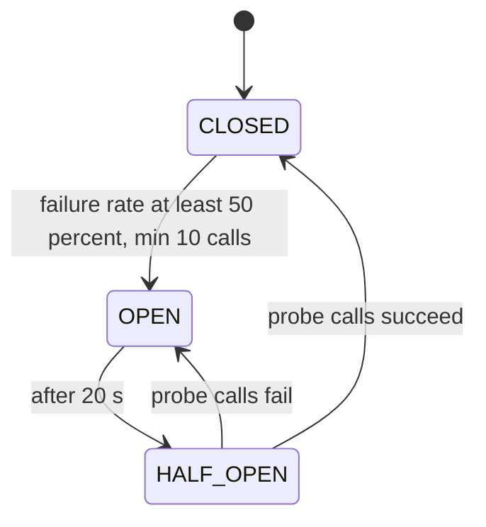

**Why the fallback sits on `@Retry`.** Resilience4j wraps calls as `Retry( CircuitBreaker( call ) )`. If the fallback were on the circuit breaker, it would swallow the exception and Retry would never see a failure. With the fallback on the outer Retry, every attempt is counted by the breaker, retries happen, and only the final outcome becomes a fallback value: `DECLINED` (card refused) or `UNAVAILABLE` (provider down or circuit open), both turned into `PaymentFailed` so the saga compensates.

**Not used (yet):** bulkhead and rate limiter on the PSP client, and a gateway-level circuit breaker filter.

---

## 10. Transactional Outbox vs Debezium CDC (and Saga)

### 10.1 What each one is

| | Transactional Outbox | Debezium CDC |
|---|---|---|
| Category | **Write-side pattern** | **Delivery mechanism** (a relay) |
| Question it answers | How do I change my data *and* record an event atomically? | How do committed rows reach Kafka reliably and fast? |
| Where it lives | Application code + an `outbox_event` table | Kafka Connect process reading the database log (WAL) |
| Guarantees | No lost event if the transaction commits; no phantom event if it rolls back | Events in commit order, resumable from a log position, at-least-once |
| Does not solve | Getting the row out of the table | Deciding *what* the event is (it only sees row changes) |

They are **complementary, not competing**: the outbox creates a trustworthy "to publish" record; something must then relay it. Debezium is one relay; a **polling publisher** (a scheduled job that reads unsent rows, sends them to Kafka, marks them sent) is another.

### 10.2 How they work with a Saga

A saga is a long business transaction made of local transactions plus compensations. Each step needs two things to be atomic: *"my local change happened"* and *"the next participant was told"*. The outbox gives that atomicity; the relay (Debezium) delivers it. In this repo even the orchestrator's **commands** (`ProcessPayment`, `ReserveInventory`) are written to the outbox together with the saga state change.

### 10.3 Your questions, answered

| Question | Answer | Best-fit example |
|---|---|---|
| **Can the Outbox work without Debezium?** | Yes. Use a polling publisher (`SELECT ... WHERE sent = false ... FOR UPDATE SKIP LOCKED`, publish, mark sent) | Medium-traffic system on a managed DB where logical replication or Kafka Connect is not available |
| **Can Debezium work without an Outbox?** | Yes: CDC directly on business tables emits raw row-change events (`orders` table inserts/updates) | Syncing orders to Elasticsearch, a data lake, or cache invalidation, where consumers can live with table-shaped events |
| **When is *only Outbox* right with a Saga?** | Low to moderate volume, latency of 0.5 to 2 s is fine, you want few moving parts, no Connect cluster to operate | Internal back-office workflow: 20 orders/min, saga steps over RabbitMQ or Kafka, polling every 500 ms |
| **When is *only Debezium CDC* right with a Saga?** | When the saga state/changes are already rows in tables and you accept that events mirror the schema; or when you cannot change legacy code | Legacy monolith being strangled: capture changes from its tables and drive new services' sagas, with an anti-corruption mapper |
| **When use *both together*?** | High volume, low latency, many consumers, need for domain-shaped events and no dual writes | **This project**: outbox rows give clean domain events and commands; Debezium relays them in about a second with no polling load |
| **Can they work without a Saga?** | Yes. Reliable event publication is useful on its own | Outbox: "send welcome email after sign-up". CDC: replicate data into analytics. Both: publish `OrderStatusChanged` to feed a read model (CQRS) with no saga involved |
| **Can a Saga work without either?** | Technically yes (publish to the broker inside the transaction), but it risks lost or duplicate commands after crashes. Avoid for money-moving flows | Prototype only |

### 10.4 Decision guide

| Need | Pick |
|---|---|
| Smallest ops footprint | Outbox + polling publisher |
| Lowest latency, highest throughput, no polling load | Outbox + Debezium (this repo) |
| Cannot modify the source application | CDC on tables (+ transform) |
| Need domain events, not row changes | Outbox (with or without CDC) |
| Several consumers need the same data stream | CDC / Kafka topic |
| Strict global ordering needs | Not supported by either; order per aggregate key only (we key by `orderId`) |

### 10.5 What this repo does, concretely

1. `OutboxRepository.append(...)` inserts `(aggregate_type, aggregate_id, event_type, payload)` inside the caller's transaction.
2. Debezium's **EventRouter** transform maps `aggregate_type` to the topic (`restaurant.events.<aggregate_type>`), `aggregate_id` to the Kafka key, `payload` to the value (`table.expand.json.payload=true`), and `event_type` / `id` to headers.
3. Consumers dedupe with the `eventId` header.
4. `OutboxCleaner` deletes rows older than 1 hour (safe because Debezium reads the WAL, not the table).

---

## 11. Failure scenarios and compensation flows

> **Simulated gateway rule.** In a booking system an example reads "a passenger name starting with `FAIL` makes the simulated payment gateway decline". In this restaurant system the equivalent is: **an order whose total is above 500 is declined by the simulated PSP** (`psp.fake.decline-above: 500`), which triggers saga compensation.

### F1. Payment declined (order total above 500)

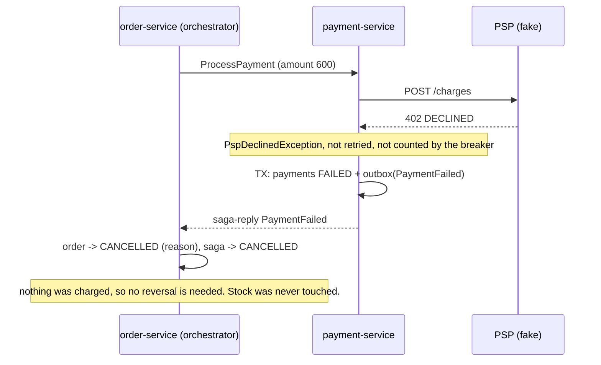

Result: `CANCELLED`, query API shows the cancellation, no ticket is created.

### F2. Out of stock after a successful payment (compensation with refund)

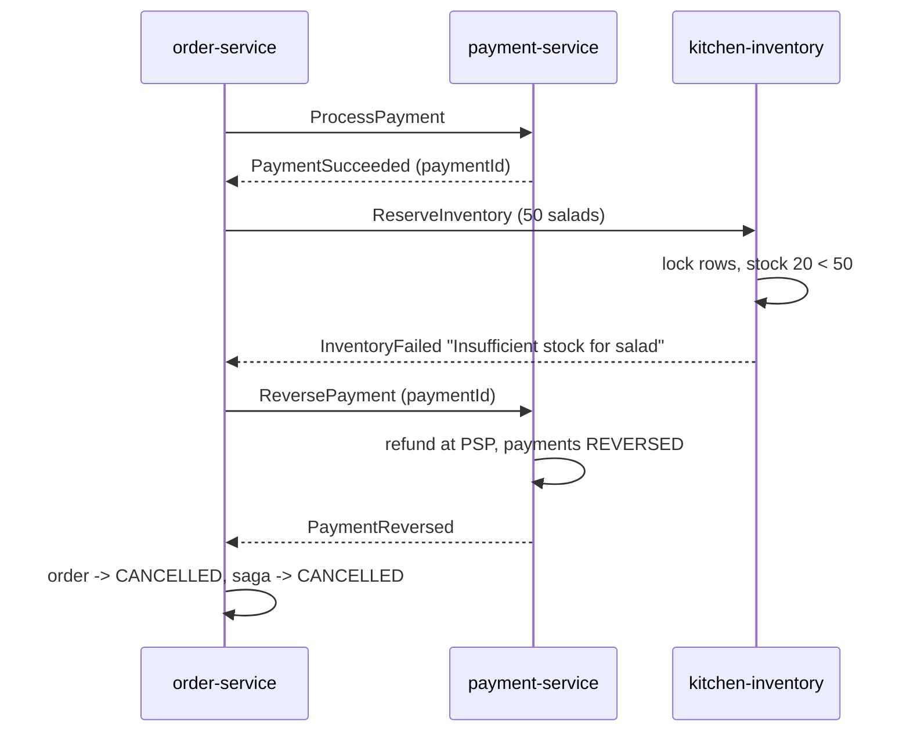

### F3. Payment provider outage (retry, circuit breaker, fallback)

1. `PspClient.charge` fails (timeout / 5xx). Retry waits about 200 ms, 400 ms, 800 ms (jittered) and tries again, up to 4 attempts. Each attempt is recorded by the circuit breaker.
2. After about 10 calls with 50% failures the circuit **opens**: further calls fail immediately (`CallNotPermittedException`), protecting threads and the provider.
3. Retries are exhausted or the circuit is open: the fallback returns `UNAVAILABLE`, recorded as `PaymentFailed("Payment provider unavailable")`.
4. The saga cancels the order. After 20 s the breaker goes HALF_OPEN and probes the provider.

### F4. A participant never answers (timeout)

`SagaTimeoutScheduler` runs every 30 s and finds sagas in `PAYMENT_PENDING`, `INVENTORY_PENDING` or `COMPENSATING_PAYMENT` older than `saga.timeout` (2 min). `OrderSagaOrchestrator.timeout`:
- `PAYMENT_PENDING` / `INVENTORY_PENDING`: set failure reason, send `ReversePayment`, state `COMPENSATING_PAYMENT` (reversal is sent **even if no payment is known**, because a late charge may still be in flight; commands are ordered per order key, so the refund always runs after the charge).
- `COMPENSATING_PAYMENT`: resend `ReversePayment` (the payment service answers idempotently).
- Once `PaymentReversed` arrives, the order is cancelled.

### F5. Duplicate, late or out-of-order messages

- Same Kafka record twice: `processed_message` already contains the `eventId`, so the work is skipped.
- A reply that does not fit the current saga state (for example `PaymentFailed` after `COMPLETED`): ignored by the `default` branch of the orchestrator's `switch`.
- Two things update the saga at once (reply vs timeout): `@Version` raises an optimistic-lock error; the loser is retried by the listener or skipped by the scheduler and re-evaluates the fresh state.

### F6. Poison message (cannot ever be processed)

`DefaultErrorHandler` retries with exponential backoff (500 ms, x2, 5 attempts), then `DeadLetterPublishingRecoverer` publishes the record to `<topic>.DLT` and the consumer moves on. Inspect the DLT in Kafka UI, fix the cause, and republish if needed. (`order-service` currently uses Spring's default handler without a DLT; see Section 16.)

### F7. Kafka or Debezium unavailable

Orders are still accepted: state and outbox rows commit in PostgreSQL. Debezium resumes from its replication-slot position and publishes everything in order. If the pause is longer than `saga.timeout`, the watchdog compensates affected orders. **Watch the replication slot size** (an unconsumed slot makes the WAL grow).

### F8. A service database is down

That service returns errors or stops consuming; messages stay in Kafka and are processed after recovery. Other services keep working (database per service).

### F9. Not authorized

Missing or invalid token: `401`. Valid token but wrong role, wrong location, or closed hours: `403`. A skipped or repeated ticket step: `409`. Validation errors on order creation: `400`.

### F10. Read model out of sync

Use the rebuild: `DELETE :8082/admin/read-model`, `POST :8081/admin/replay/orders`, then compare `GET :8082/admin/read-model/stats` with `select count(*) from orders`.

---

## 12. AWS edge: Route 53, CloudFront, WAF, Shield Advanced

All of this is defined in `infra/terraform/edge.tf` and `alb.tf`; this section explains the **concepts and manual steps** around those files.

### 12.1 Request path and what each layer does

```
User -> Route 53 -> CloudFront (+ WAF, + Shield) -> public ALB -> api-gateway
          DNS         CDN / TLS / filtering         origin lock     JWT + limits
```

| Layer | Job | Terraform resource |
|---|---|---|
| Route 53 | Resolves `api.example.com` to CloudFront; health check watches the API | `aws_route53_record.api`, `aws_route53_health_check.api` |
| Route 53 (origin name) | `origin.api.example.com` points at the ALB, so the ALB certificate can match the name CloudFront uses | `aws_route53_record.origin` |
| WAF | Blocks common web attacks before they reach your servers | `aws_wafv2_web_acl.edge` |
| Shield Advanced | DDoS protection with cost protection and the AWS response team | `aws_shield_protection.cloudfront`, `.alb` (optional) |
| CloudFront | Global edge, TLS termination, HTTP/2 and HTTP/3; **does not cache** API calls | `aws_cloudfront_distribution.edge` |
| Public ALB | Accepts only CloudFront traffic carrying the secret header | `aws_lb.public`, listener rule `from_cloudfront` |

### 12.2 DNS configuration (Route 53)

1. Own or register a domain and create (or delegate) a **public hosted zone**; note the zone id (`hosted_zone_id`).
2. Choose `domain_name` (for example `api.example.com`). Terraform creates:
   - **A (alias)** `api.example.com` to the CloudFront distribution (alias records are free and work at any name, no CNAME limits).
   - **A (alias)** `origin.api.example.com` to the ALB, with `evaluate_target_health = true`.
   - **Health check**: HTTPS on `api.example.com:443` path `/actuator/health`, every 30 s, 3 failures mark it unhealthy. Attach a CloudWatch alarm or SNS topic to it to get alerts. For multi-region failover you would add a second region and **failover/latency routing** records that reference this health check (single region today).
3. Verify: `nslookup api.example.com` returns CloudFront addresses; `nslookup origin.api.example.com` returns ALB addresses.

### 12.3 TLS certificates (ACM, created before `terraform apply`)

| Certificate | Region | Names | Variable |
|---|---|---|---|
| For CloudFront (viewer side) | **us-east-1** (mandatory) | `api.example.com` | `cloudfront_certificate_arn` |
| For the ALB (origin side) | the stack's region | `origin.api.example.com` | `alb_certificate_arn` |

Use DNS validation (ACM gives a CNAME to add to the hosted zone).

### 12.4 CDN configuration (CloudFront)

| Setting | Value | Why |
|---|---|---|
| Origin | `origin.<domain>`, HTTPS only, TLS 1.2 | encrypted hop to the ALB |
| Custom header | `X-Origin-Verify: <secret>` (`origin_verify_secret`) | the ALB forwards only requests that carry it, so nobody can bypass CloudFront by calling the ALB directly |
| Cache policy | `Managed-CachingDisabled` (`4135ea2d-...`) | API responses are user-specific and must not be cached |
| Origin request policy | `Managed-AllViewer` (`216adef6-...`) | forwards `Authorization`, query strings, cookies and headers |
| Allowed methods | GET, HEAD, OPTIONS, PUT, POST, PATCH, DELETE | full REST API |
| Viewer protocol | redirect HTTP to HTTPS; TLS `TLSv1.2_2021` | modern TLS only |
| Price class | `PriceClass_100` | cheaper edge subset; raise for global audiences |

You can cache public, static or catalog-style GET endpoints later with an extra cache behavior (for example `/api/menu/*`); the order APIs must stay uncached.

### 12.5 WAF (web application firewall)

Defined in `aws_wafv2_web_acl.edge` (scope `CLOUDFRONT`, so it lives in us-east-1):

| Rule | Priority | Purpose |
|---|---|---|
| `rate-limit-per-ip` (rate-based, 2000 requests per 5 minutes per IP) | 5 | blunt volumetric abuse before it reaches the gateway |
| `AWSManagedRulesCommonRuleSet` | 10 | OWASP-style protections (XSS, bad bots, size limits) |
| `AWSManagedRulesKnownBadInputsRuleSet` | 20 | Log4Shell-style and known exploit payloads |
| `AWSManagedRulesSQLiRuleSet` | 30 | SQL injection patterns |
| `AWSManagedRulesAmazonIpReputationList` | 40 | known malicious IPs |

Operating tips: first run new rules in **Count** mode (change `override_action { none {} }` to `count {}`), watch sampled requests, then enforce. Enable WAF logging to CloudWatch/S3/Firehose for forensics. WAF (edge, per IP) and the gateway rate limiter (per user) are complementary layers.

### 12.6 Shield Advanced

- Shield **Standard** is automatic and free. **Advanced** needs an account-level subscription (a significant monthly fee with a one-year commitment; check current AWS pricing) made in the console or via CLI **before** Terraform can attach protections.
- Set `enable_shield_advanced = true` to create `aws_shield_protection` for the CloudFront distribution and the ALB. You get layer 7 DDoS detection (with WAF), DDoS cost protection, and access to the Shield Response Team (you may need to grant them access).
- If you do not need it, leave it `false` (default). The rest of the stack works the same.

### 12.7 Verify the edge

| Check | Command | Expected |
|---|---|---|
| HTTPS and CloudFront | `curl -I https://api.example.com/actuator/health` | `200`, header `x-cache: Miss from cloudfront` |
| ALB cannot be bypassed | `curl -k https://<alb-dns>/actuator/health` | `403 Forbidden` (no secret header) or connection refused (security group) |
| WAF blocks attacks | `curl "https://api.example.com/api/query/orders/mine?q=<script>alert(1)</script>"` | `403` from WAF |
| Rate rule | send more than 2000 requests in 5 minutes from one IP | `403` (blocked), visible in WAF metrics |

---

## 13. Terraform guide

### 13.1 Where to start reading

Terraform loads **every `.tf` file in the folder** and builds a dependency graph; file names and order do not matter to Terraform. For **humans**, read in this order (each file builds on the previous):

| # | File | Read it to understand | Key resources |
|---|---|---|---|
| 1 | `versions.tf` | Terraform and provider versions; the two AWS provider configurations (default region + `us_east_1` alias for CloudFront-scoped WAF and Shield) | `provider "aws"` x2 |
| 2 | `variables.tf` | Every input you can set (domain, certificates, sizes, secrets). Start here to know what to prepare | `variable` blocks |
| 3 | `network.tf` | The network: VPC, 3 AZs x 3 subnet tiers (**public** for ALB/NAT, **private** for ECS, **data** for databases with no internet route), NAT, route tables, S3 endpoint | `aws_vpc`, `aws_subnet`, `aws_nat_gateway`, `aws_route_table` |
| 4 | `security.tf` | Who may talk to whom (security groups): ALB only from CloudFront's prefix list, ECS only from the ALB on 8080 and from itself, data stores only from ECS (and Connect) | `aws_security_group` |
| 5 | `alb.tf` | The public load balancer, gateway target group, HTTPS listener, the **secret-header rule** | `aws_lb`, `aws_lb_listener`, `aws_lb_listener_rule` |
| 6 | `edge.tf` | WAF, CloudFront, Route 53 records and health check, Shield | `aws_wafv2_web_acl`, `aws_cloudfront_distribution`, `aws_route53_*` |
| 7 | `data.tf` | State and messaging: 4 PostgreSQL instances (logical replication on), Redis, DocumentDB, MSK Kafka, MSK Connect Debezium connectors, Mongo URI secret | `aws_db_instance`, `aws_elasticache_*`, `aws_docdb_*`, `aws_msk_*`, `aws_mskconnect_*` |
| 8 | `ecs.tf` | Compute: ECR repos, ECS cluster, **Cloud Map**, IAM roles, one task definition and one service per microservice, gateway autoscaling | `aws_ecs_*`, `aws_service_discovery_*`, `aws_iam_*` |
| 9 | `outputs.tf` | Values printed after apply (API URL, ECR URLs, Kafka brokers, DB endpoints) | `output` |
| - | `terraform.tfvars.example` | A filled-in example of the inputs | copy to `terraform.tfvars` |
| - | `README.md` (in `infra/terraform`) | Quick reference and known limits | |

### 13.2 How the pieces connect

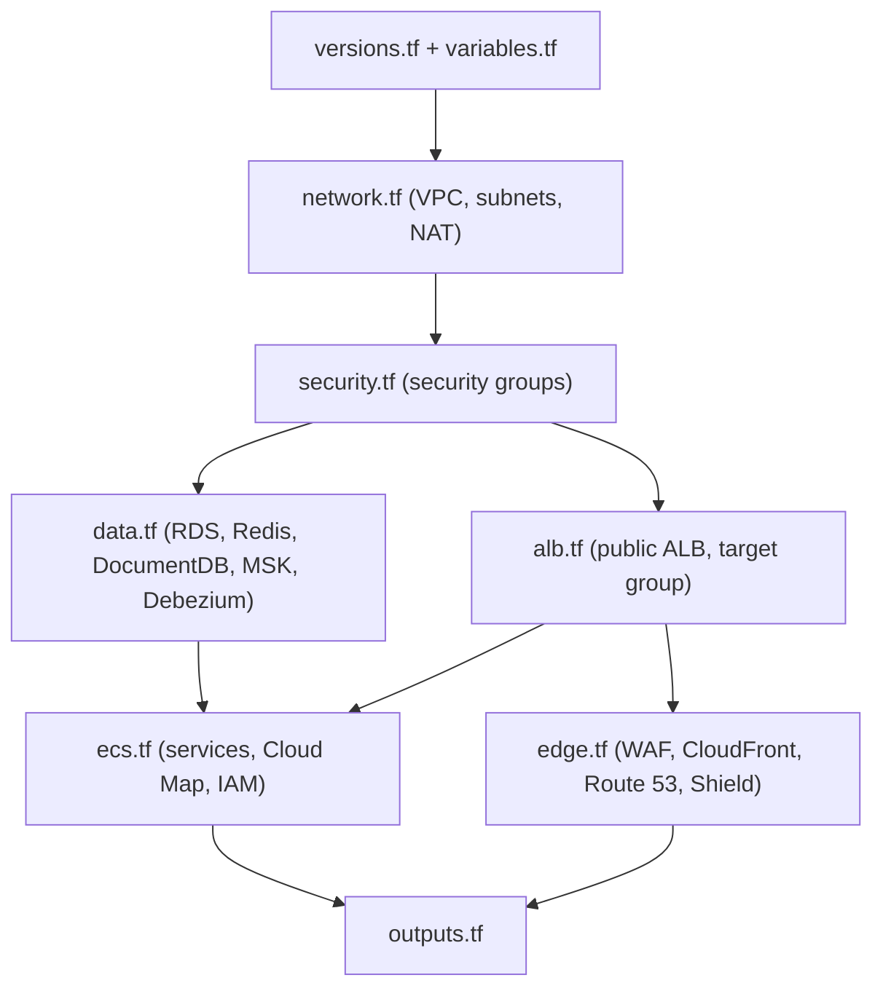

Example of Terraform's implicit dependency handling: in `ecs.tf` the task environment uses `aws_db_instance.this[k].address` and `aws_msk_cluster.main.bootstrap_brokers_tls`; Terraform therefore creates the databases and Kafka cluster **before** the ECS services, without you ordering anything.

### 13.3 Concepts for beginners (with examples from these files)

| Concept | Example in the repo |
|---|---|
| `variable` / `locals` / `output` | `var.domain_name`, `local.services` in `ecs.tf`, `output "api_url"` |
| `resource` | `resource "aws_lb" "public" { ... }` creates a load balancer |
| `data` source (read-only lookup) | `data "aws_availability_zones" "available"`, the CloudFront managed prefix list |
| `count` | one subnet per AZ: `count = var.az_count` |
| `for_each` | one RDS instance per entry of `local.databases`; one ECS service per microservice |
| `dynamic` block | WAF managed rules generated from `local.waf_managed_rules` |
| Implicit dependency | referencing `aws_vpc.main.id` makes Terraform build the VPC first |
| Provider alias | `provider = aws.us_east_1` for CloudFront-scoped WAF |
| Sensitive values | `origin_verify_secret`, `docdb_master_password` are `sensitive = true`; RDS passwords use `manage_master_user_password = true` so they live in Secrets Manager, not in Terraform state |

### 13.4 Run it

```
cd infra/terraform
cp terraform.tfvars.example terraform.tfvars     # fill in your values
terraform init                                   # downloads the AWS provider
terraform fmt -check && terraform validate       # style + syntax/type check (no AWS calls)
terraform apply -target=aws_ecr_repository.svc   # optional: create image repositories first, push images
terraform plan -out tfplan                       # preview: what will be created
terraform apply tfplan                           # create everything
terraform destroy                                # delete everything (careful: databases)
```

Before applying: create the ACM certificates, a Debezium plugin ZIP in S3 (`debezium_plugin_*`), and build/push the six images with the repo `Dockerfile` (`docker build --build-arg MODULE=order-service ...`). After the first apply reboot the RDS instances once so `rds.logical_replication` takes effect.

> **Status.** The `.tf` files are syntax-checked but have **not** been applied against a real AWS account. State is stored locally; for team use add an S3 + DynamoDB (or S3 lockfile) `backend` block. Expect to iterate on `terraform plan` output.

### 13.4a What gets created (size and cost warning)

6 Fargate services (some x2 tasks), 4 RDS instances, 3-node MSK, 2-node Redis, 2-node DocumentDB, NAT gateway, ALB, CloudFront, WAF. This is a production-shaped footprint, so it costs real money; destroy dev environments when idle.

### 13.5 Why Terraform and not Ansible?

| Topic | Terraform | Ansible |
|---|---|---|
| Style | **Declarative**: describe the desired end state | Mostly **procedural**: list tasks to run in order |
| Primary strength | **Provisioning infrastructure** (networks, load balancers, databases, DNS, IAM) | **Configuring machines** (packages, files, services on servers) |
| State | Keeps a **state file**: knows what exists, computes a diff, and can delete exactly what it created | Stateless: no built-in memory of what exists, so cleanup and drift detection are manual |
| Preview | `terraform plan` shows exactly what will change before anything happens | Check mode exists but is less precise for cloud resources |
| Dependency handling | Automatic graph from references (VPC before subnets before ALB) | You order tasks yourself |
| Idempotency for cloud objects | Native per resource | Depends on each module's quality |
| Fit for this project | Everything here is managed AWS services and containers; there are **no servers to configure** | Would add little: no VMs, no OS-level configuration |

Benefits we actually get here: one reviewed plan before any change; repeatable environments (dev/stage/prod from the same code with different `tfvars`); drift detection (`terraform plan` shows manual console edits); safe teardown; module-free, readable files; the same tool covers Route 53, CloudFront, WAF, ECS, RDS and MSK.

Fair caveats: state must be protected (it can contain sensitive values); provider upgrades need testing; and in a real organization CloudFormation/CDK or Pulumi are valid alternatives. A common split is "Terraform for infrastructure, container images for configuration", with Ansible only where you still manage servers.

---

## 14. Kubernetes (status and a beginner's learning path)

### 14.1 Status: there are no Kubernetes files in this repository

The platform runs on **Amazon ECS on Fargate**, defined in `infra/terraform/ecs.tf`. I am stating this plainly because some reference architectures use Kubernetes (EKS); **no Deployment, Service, Ingress, ConfigMap, Secret or HPA manifests exist here**, and nothing in this section should be read as describing files you can open.

### 14.2 Concept mapping (ECS in this repo to Kubernetes)

| Kubernetes object | Equivalent in this repo | File |
|---|---|---|
| Container image | `Dockerfile` (one recipe, `MODULE` build arg) pushed to ECR | `Dockerfile`, `ecs.tf` (`aws_ecr_repository`) |
| Pod spec / container | `aws_ecs_task_definition` (image, CPU, memory, ports, env, secrets, log config) | `ecs.tf` |
| Deployment (replicas, rolling update) | `aws_ecs_service` (`desired_count`, deployment circuit breaker with rollback) | `ecs.tf` |
| Service (stable DNS name) | AWS Cloud Map (`aws_service_discovery_service`) | `ecs.tf` |
| Ingress / Ingress controller | Public ALB + target group + listener rule | `alb.tf` |
| ConfigMap | task `environment` entries (`local.common_env`, `local.db_env`) | `ecs.tf` |
| Secret | task `secrets` pulling from AWS Secrets Manager | `ecs.tf`, `data.tf` |
| HorizontalPodAutoscaler | `aws_appautoscaling_*` (gateway CPU 60%) | `ecs.tf` |
| NetworkPolicy | security groups | `security.tf` |
| Namespace / cluster | `aws_ecs_cluster` | `ecs.tf` |
| Liveness / readiness probes | ALB health check on `/actuator/health` (gateway only) | `alb.tf` |

### 14.3 If you are a beginner and want to understand the container-orchestration flow

Follow this path through the files that **do** exist; the same ideas carry over to Kubernetes.

| Step | Open this | What to learn | Example to try |
|---|---|---|---|
| 1 | `Dockerfile` | A service becomes an image: build stage (`mvn package`) then slim runtime stage | `docker build --build-arg MODULE=order-service -t order-service:dev .` |
| 2 | `local-stack/docker-compose.yml` | Running several containers together, ports, volumes, env vars | `docker compose up -d`, `docker compose ps` |
| 3 | one service `application.yml` (for example `order-service`) | **Externalized configuration**: `${DB_URL:default}` placeholders are how env vars (ConfigMap/Secret equivalents) reach the app | run with `DB_URL=...` set |
| 4 | `infra/terraform/ecs.tf`, block `local.services` | The list of services, ports, CPU/memory, replicas | change `desired` for one service |
| 5 | `ecs.tf`, `aws_ecs_task_definition` | One container definition: image, env, secrets, logs | find where `DB_PASSWORD` comes from |
| 6 | `ecs.tf`, `aws_ecs_service` | Running N copies, private subnets, rollout with automatic rollback | note `deployment_circuit_breaker` |
| 7 | `ecs.tf`, Cloud Map resources | Service discovery: `order-service.restaurant.local` | see gateway env `ORDER_URL` |
| 8 | `alb.tf` then `edge.tf` | How external traffic enters | trace one request from Route 53 to the gateway |
| 9 | `security.tf` | Network isolation (the role NetworkPolicy plays in Kubernetes) | find which SG may reach Postgres |

### 14.4 Adding Kubernetes (offer, not present)

A typical conversion would add: a `k8s/` folder with per-service `Deployment` + `Service`, a shared `ConfigMap`/`Secret` (or External Secrets), an `Ingress` (AWS Load Balancer Controller) replacing `alb.tf`, `HorizontalPodAutoscaler`s, `PodDisruptionBudget`s, and either an EKS Terraform module or `kubectl`/Helm/Kustomize deployments, plus Kafka/Debezium via MSK Connect or Strimzi. If you want it, ask and it can be added as a separate, tested change.

---

## 15. Security, reliability and compliance summary

| Area | What is implemented |
|---|---|
| Edge | WAF managed rules + per-IP rate rule, optional Shield Advanced, CloudFront TLS 1.2+, ALB accepts only CloudFront (prefix list + secret header) |
| Authentication | OIDC/JWT everywhere (gateway **and** services) |
| Authorization | RBAC hierarchy + ABAC evaluators (owner, location, hours, state) |
| Abuse control | Per-user token bucket at the gateway, per-IP rule at WAF |
| Data protection | Encrypted RDS/Redis/DocumentDB (Terraform), managed DB passwords in Secrets Manager, no card data stored |
| Network | 3-tier VPC, data tier without internet route, security-group allow-lists |
| Messaging reliability | Outbox + CDC (no dual write), idempotent consumers, DLT, saga timeouts, optimistic locking |
| Resilience | Retry + exponential backoff + jitter, circuit breaker, fallback, graceful compensation |
| Observability | Actuator health endpoints, Kafka UI, structured state in DB tables (saga, payments, reservations, tickets), CloudWatch log groups on AWS |

Compliance notes (not a certification): payment data stays with the PSP (tokenized flow reduces PCI scope); personal data is limited to a user id; events provide an audit trail; for GDPR-style requests you would need delete/anonymize procedures for events and the read model (not implemented).

---

## 16. Known limitations and roadmap

Honest list of what is missing or simplified:

| Area | Limitation | Suggested next step |
|---|---|---|
| Service discovery | No Eureka (by design) | Add only if you need client-side load balancing |
| Kubernetes | No manifests | Add `k8s/` or an EKS module on request |
| mTLS | Not implemented; plain HTTP inside the VPC | Service mesh (App Mesh/Istio) or per-service certificates |
| Caching | No Caffeine/Redis cache in the query service | Add Spring Cache with Caffeine (L1) + Redis (L2), evict on events |
| Kafka error handling | `order-service` lacks a dead-letter handler | Reuse the `KafkaConfig` pattern from the other services |
| Circuit breaker | Only on the PSP client; no gateway filter, no bulkhead | Wire the gateway `CircuitBreaker` filter to `FallbackController` |
| Observability | No Prometheus/OpenTelemetry/tracing dependencies | Add Micrometer registry + tracing; propagate `traceparent` in outbox headers |
| Opening hours | Placeholder (08:00-23:00 UTC) in `DefaultLocationHoursProvider` | Real per-location schedule |
| Inventory | No stock release after a completed order is cancelled; `GET /inventory` unauthenticated | Add release command; secure or remove endpoint |
| Payments | Simulated PSP | Integrate a real provider; add bulkhead/rate limiter |
| Order cancellation | No customer-initiated cancel endpoint | Needs saga-aware cancellation design |
| Security | Local demo uses the password grant | Authorization Code + PKCE, MFA, short token lifetime |
| Terraform | Not applied to real AWS; local state; Debezium DB password placed in connector config | Remote backend, secrets config provider |
| Tests | Integration tests need Docker; no load or chaos tests | Add k6/Gatling and failure-injection suites |

---

## 17. Troubleshooting

| Symptom | Likely cause | Fix |
|---|---|---|
| `Mockito cannot mock this class ... Java 25 is not supported by Byte Buddy` | Maven runs on JDK 24/25 | Already handled by `-Dnet.bytebuddy.experimental=true` in the parent POM; or run Maven with JDK 21 |
| Integration tests show *Skipped* | Docker not running | Start Docker Desktop (they skip automatically without it) |
| Orders stay `PAYMENT_PENDING` | Connectors not registered or Debezium stopped | `curl.exe http://localhost:8083/connectors/orders-outbox/status`; run `register-connectors.cmd` |
| Connector fails with "table not found" | Registered before Flyway created the tables | Start order, payment and kitchen-inventory services first, then register |
| `database "workflow" does not exist` | Existing Postgres volume from an older stack | `docker compose exec postgres psql -U postgres -c "CREATE DATABASE workflow;"` |
| 401 on every call | Token missing, expired, or issuer mismatch | Get a fresh token from `http://localhost:8180/...`; issuer must be `http://localhost:8180/realms/restaurant` |
| 403 for chef/manager calls | No `restaurantLocationId` claim in the token or location mismatch | Check the token at jwt.io; verify the Keycloak user attribute and mapper |
| 403 "outside hours" | Placeholder hours (08:00-23:00 UTC) | Test during those hours or change `DefaultLocationHoursProvider` |
| 429 immediately | Rate limit (20 req/s, burst 40) | Slow down or raise `redis-rate-limiter.*` |
| Query API returns 404 right after an order | Projection lag | Wait 1-2 s and retry |
| Flyway "non-empty schema" error | Tables created by an old init script | `docker compose down -v` and start again |
| Keycloak realm missing | Import still running or volume mount failed | Wait 60 s; check `docker compose logs keycloak`; ensure `local-stack/keycloak/restaurant-realm.json` exists |

---

*Further reading inside the repo:* `PROJECT_STRUCTURE.md` (class-by-class map), `local-stack/README.md`, `infra/terraform/README.md`.
